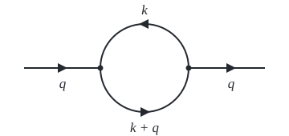

# zippel

A bunch libraries to support doing Feynman integral reduction by sparse interpolation over finite fields in Rust.

IBP systems are eliminated numerically modulo word-sized primes, and the exact rational coefficients are recovered from evaluations alone.

- [`zippel-interp`](crates/interp): Zippel's black-box sparse polynomial interpolation over prime fields
- [`zippel-interp::rational`](crates/interp/src/rational.rs): Rational function reconstruction ala the method of Thiele and Zippel
- [`zippel-interp::benor`](crates/interp/src/benor.rs): Ben-Or/Tiwari interpolation from about two evaluations per term
- [`zippel-interp::geometric`](crates/interp/src/geometric.rs): Sparse recovery with smooth-subgroup exponent decoding
- [`zippel-lift`](crates/lift): Lifts to Q by CRT and rational number reconstruction
- [`zippel-laporta`](crates/laporta): IBP generation and Laporta elimination over GF(p)
- [`zippel-laporta::block`](crates/laporta/src/block.rs): Adaptive block-triangular reduction over GF(p)
- [`zippel-gcd`](crates/gcd): Multivariate GCD, cofactors and LCM of [polycore](https://crates.io/crates/polycore) polynomials
- [`zippel-gcd::zippel`](crates/gcd/src/pgcd.rs): Zippel's modular GCD with LINZIP interpolation
- [`zippel-gcd::huang_gao`](crates/gcd/src/huang_gao.rs): Huang–Gao GCD by separated Hensel lifting (asymptotic SOTA, 2026)
- [`zippel-gcd::huang_monagan`](crates/gcd/src/huang_monagan.rs): Huang–Monagan GCD by prime substitution
- [`zippel-gcd::hu_monagan`](crates/gcd/src/hu_monagan.rs): Hu–Monagan GCD and cofactor interpolation
- [`zippel-gcd::hu_monagan_bivariate`](crates/gcd/src/hu_monagan.rs): Hu–Monagan GCD with bivariate images

```bash
cargo build
cargo test
```

```bash
cargo run -p zippel-interp --example determinant
cargo run -p zippel-interp --example linsolve
cargo run -p zippel-laporta --example hello
cargo run -p zippel-laporta --example bubble
cargo run --release -p zippel-laporta --example box
cargo run --release -p zippel-laporta --example double_box
cargo run -p zippel-gcd --example demo
```

## Example

The massless one-loop bubble with dots, reduced to its master integral $I(1,1)$, where

$$
I(a_1, a_2) = \int \frac{d^d k}{(k^2)^{a_1} ((k + q)^2)^{a_2}}, \qquad q^2 = s.
$$

<p align="center">
  <picture>
    <source media="(prefers-color-scheme: dark)" srcset=".github/bubble-dark.svg">
    
  </picture>
</p>

```rust
use zippel_laporta::ibp::Family;

let bubble = Family {
    vars: ["d", "s"].map(String::from).to_vec(),
    loops: 1,
    props: vec![(vec![1, 0], vec![]), (vec![1, 1], vec![])], // k^2, (k + q)^2
    lines: 2,
    legs: vec![vec![vec![0, 0, 2]]], // 2 q.q = 2s
    symmetries: vec![vec![1, 0]],
};
let (system, plan, coefficients) = bubble.reduce(&[vec![2, 1], vec![2, 2]], 2, 0).unwrap();
print!("{}", system.render(&plan, &coefficients));
```

```text
I(2,1) = (-d + 3) / (s) * I(1,1)
I(2,2) = (d^2 - 9*d + 18) / (s^2) * I(1,1)
```

## References

See [REFS.md](REFS.md).

## License

MIT Licensed. Copyright 2024-2026 Stephen Diehl. See [LICENSE](LICENSE) for details.
